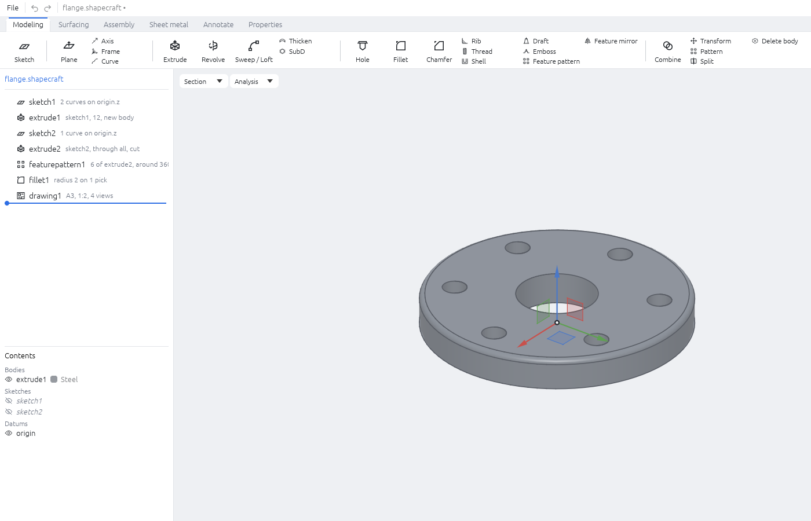
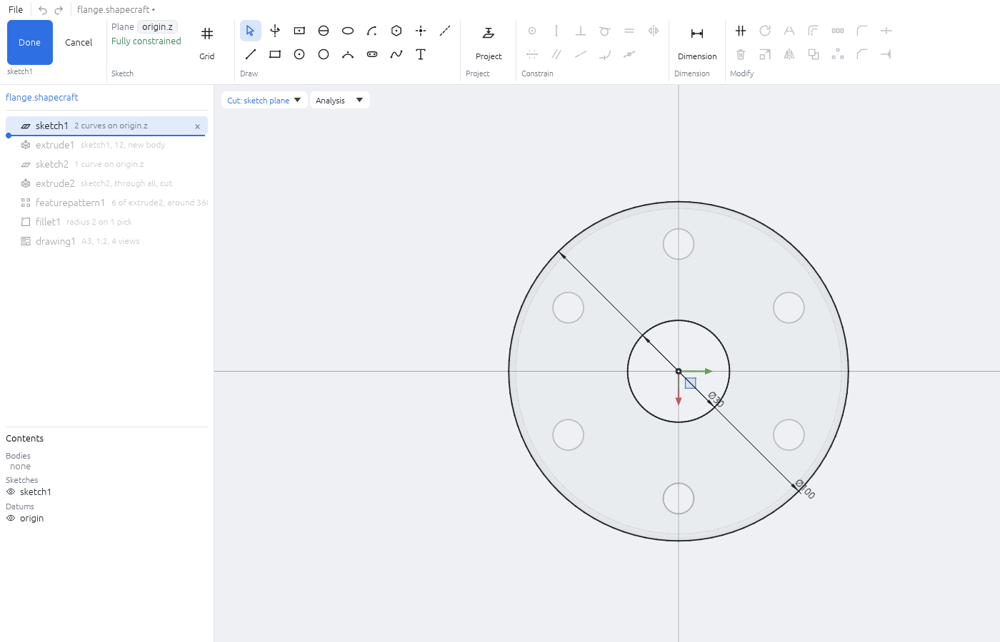
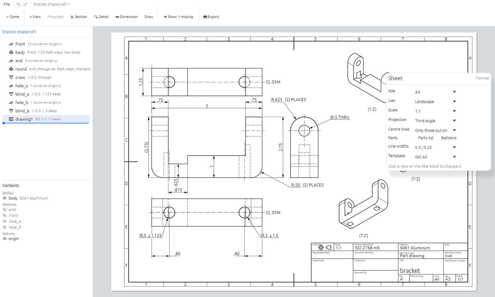

# ShapeCraft

ShapeCraft is a CAD kernel and a desktop application written in Rust. A part is a list of steps (sketches with constraints, extrudes, fillets, holes, patterns, drawings and so on) that the program applies in order to build solids and surfaces on NURBS geometry; changing an early step rebuilds the ones after it. The same parts can be edited in the app, scripted from Python through a command line, and put together into assemblies with joints and drawn on ISO sheets.

> **Status: early.** The code is a working prototype. The `.shapecraft` part file format is not stable and changes without migration, and the API of the crates is not stable. Not everything in the app is finished; [`Ribbon.md`](Ribbon.md) lists per feature what is built and what is not.

## Screenshots

The images are in [`docs/images/`](docs/images/). They show a flange built by `agent/examples/flange.py` and a bracket built by `agent/examples/bracket.py`.

| Modeling | Sketcher | Drawing |
|---|---|---|
|  |  |  |

<!-- ANCHOR: features -->
## What works today

Grouped as the tabs of the app are (see [`Ribbon.md`](https://github.com/geop-cad/ShapeCraft/blob/main/Ribbon.md) for the full list, including what is not done yet).

**Modelling** (Modeling and Surfacing tabs)
- Extrude, revolve, sweep and loft (with twist and scale, coils), thicken, stitch surfaces into solids.
- Fillet (constant or variable radius) and chamfer on edges of any NURBS shape, shell, draft, rib, emboss and engrave.
- Holes to the sizes of the standards (clearance, counterbore, countersink, tapped) and threads, cosmetic or modelled.
- Booleans (join, cut, intersect) on tolerant B-reps; a boolean that cannot be done exactly is refused with a reason.
- Split, delete body, transform, linear, circular, path, sketch and feature patterns.
- Direct edits: move, offset, delete and replace faces.
- Datums: planes, axes and frames in several constructions; curves (projected, intersection, helix, 3D spline).
- Surfaces: boundary, ruled, offset, fill hole, extend, trim, untrim, surface fillet.
- Polygon meshes and subdivision surfaces edited in the scene.
- Inspection: measure, mass properties, section analysis, interference and clearance, zebra and curvature display, draft analysis.
- Parameters and formulas, variants (a table of parameter values), materials with density, colour and a path-traced render step.

**Sketcher**
- Lines, arcs, circles, rectangles, slots, polygons, ellipses, splines, points and text.
- Constraints (coincident, horizontal, vertical, parallel, perpendicular, tangent, curvature, equal, midpoint, symmetric, fix, and more) and driving dimensions with tolerances, solved by the geometric solver in `lib/solver`; the sketch says how many degrees of freedom are left.
- Trim, extend, split, offset, mirror, move, copy, rotate, scale, patterns, fillets and chamfers; projection of edges and faces of the model into the sketch.

**Assemblies**
- Insert part files, STEP files and a catalogue of standard parts (ISO 4017 and 4762 screws, nuts, washers, ball bearings).
- Joints (rigid, revolute, slider, cylindrical, planar, ball), limits and drives, gear, rack and screw mechanisms, dragging parts within what the joints allow.
- Pattern and mirror parts, cut and weld features across parts, interference, bill of materials, exploded view.

**Sheet metal**
- Flange, bend, unfold and flat pattern.

**Drawings to ISO**
- A drawing is a step of the part: views (projected, section, detail, pictorial), dimensions with ISO 129-1 tolerances, datums (ISO 5459), centre lines, notes, balloons, parts lists, title block templates, third-angle or first-angle projection, cosmetic threads drawn as ISO 6410 has them.
- Export as PDF and DXF.

**Exchange**
- Import: STEP (AP203, AP214 and AP242 boundary representations), IGES (trimmed surfaces and the faces of its solids), STL and 3MF.
- Export: STEP (AP214), IGES, STL, 3MF; a part's outline as G-code (`.nc`).

**Python layer and command line**
- `shapecraft` (the command line) makes a part from a JSON recipe, builds it and reports what happened: which steps failed, the degrees of freedom of each sketch, the volumes after each step, the named faces and edges of the result.
- `python/shapecraft/` is a small Python library over it for writing parts as scripts (`pip install shapecraft-cad` brings it with both programs). See [`agent/README.md`](https://github.com/geop-cad/ShapeCraft/blob/main/agent/README.md) and the four scripts in [`agent/examples/`](https://github.com/geop-cad/ShapeCraft/tree/main/agent/examples).

<!-- ANCHOR_END: features -->

<!-- ANCHOR: build -->
## Build and run

You need a Rust toolchain of version 1.95 or newer (install with [rustup](https://rustup.rs/)) and a C compiler. Tested on Linux only (Ubuntu); macOS and Windows have not been tried by the authors.

On a fresh Debian or Ubuntu system:

```bash
sudo apt install build-essential git
# To run the app: the window system and OpenGL libraries, which the app loads when it starts
# (eframe/winit/glutin open them with dlopen, so they are not link-time dependencies):
sudo apt install libgl1 libegl1 libx11-6 libxcursor1 libxi6 libxrandr2 libxkbcommon0 libxkbcommon-x11-0 libwayland-client0
```

The package names of the second line are the Debian names of the libraries the binary tries to load (`libEGL`, `libX11`, `libXi`, `libxkbcommon`, `libxkbcommon-x11`, Wayland); they have not been tried on a fresh install.

```bash
git clone https://github.com/geop-cad/ShapeCraft.git
cd ShapeCraft

# The desktop app (optimized build: the geometry is slow without the optimizer)
cargo run --release -p shapecraft-app
cargo run --release -p shapecraft-app -- part.shapecraft   # open a part file

# The command line
cargo build --release -p shapecraft-cli
target/release/shapecraft kinds                          # the kinds of steps and their arguments
target/release/shapecraft make recipe.json -o part.shapecraft --report report.json
target/release/shapecraft report part.shapecraft         # build a part there is, and say what came of it

# A part from Python (builds the command line first; needs Python 3)
cargo build --release -p shapecraft-cli
PYTHONPATH=python python3 agent/examples/flange.py   # or: pip install ./python, which also builds both programs
```

`SHAPECRAFT_DEMO=1 cargo run --release -p shapecraft-app` opens a small assembly instead of an empty part (`SHAPECRAFT_DEMO` also takes `sketch`, `blends` and `joints`). The app keeps its settings and library of materials in a configuration folder, which `SHAPECRAFT_CONFIG_DIR` overrides.

<!-- ANCHOR_END: build -->

## Repository layout

| Folder | What is in it |
|---|---|
| `core/` | The modelling core: the world (topology, datums, profiles), references, the operation trait, the builder, the registry. `core/derive` has its derive macros. |
| `lib/` | Geometry libraries without operations: `boolean` (booleans on NURBS B-reps), `shape` (sweeps, blends, offsets, shells), `solver` (the constraint solver), `render` (a small path tracer). |
| `ops/` | One crate per family of operations (sketch, sweep, blend, faces, bodies, features, datum, drawing, annotate, mesh, sheet metal, surface, instances, standard parts, STEP/IGES/STL/3MF import and export, appearance, basic shapes); `ops/testing` holds what their tests share. |
| `cad/` | Parts and the workspace that builds them (`cad-part`), the application state and view (`cad-ui`), and buffers for drawing and picking (`cad-rasterize`). |
| `hosts/` | The programs: `app` (desktop application, egui with OpenGL) and `cli` (the `shapecraft` command). |
| `agent/` | The Python layer over the command line, and its examples. |
| `bench/` | Benchmarks: `boolean` and `conformance`. |
| `docs/` | Documentation: [`ARCHITECTURE.md`](docs/ARCHITECTURE.md), screenshots, and the book sources (`docs/book/`). |
| `website/` | The static landing page. |

How the pieces fit together is described in [`docs/ARCHITECTURE.md`](docs/ARCHITECTURE.md).

## Tests and benchmarks

```bash
cargo test --workspace                                  # unit and integration tests
cargo clippy --workspace --all-targets -- -D warnings
cargo fmt --all -- --check
```

Two benchmarks are not part of `cargo test`:

- `bench/boolean` (`cargo run --release -p shapecraft-boolean-bench`) grades the booleans on closed-form cases, near misses, random pairs and public STEP files as pass, refused or wrong. Run it after changing `lib/boolean` or the STEP importer; it needs `-- fetch` once to download the data sets (not stored in the repository) and takes minutes. See [`bench/boolean/README.md`](bench/boolean/README.md).
- `bench/conformance` is an adapter that lets the third-party [brep-conformance](https://github.com/springcraft-ai/brep-conformance) suite drive ShapeCraft (one JSON request per line on stdin, one reply per line on stdout), with the scripts that run it in a sandbox. See [`bench/conformance/README.md`](bench/conformance/README.md).

The results of both, with the third-party benchmarks they come from, how to reproduce them and what is published for other kernels, are in [`docs/benchmarks`](docs/benchmarks/README.md).

## Licence

Licensed under either of

- Apache License, Version 2.0 ([`LICENSE-APACHE`](LICENSE-APACHE))
- MIT license ([`LICENSE-MIT`](LICENSE-MIT))

at your option. Unless you explicitly state otherwise, any contribution intentionally submitted for inclusion in ShapeCraft by you, as defined in the Apache-2.0 licence, shall be dual licensed as above, without any additional terms or conditions.

The icons, the application icon and the example models in this repository are original to the project and
are covered by the same licence. Open CASCADE, KiCad, FreeCAD, STEP and other names belong to their owners;
they are named only to identify them.

## Contributing

See [`CONTRIBUTING.md`](CONTRIBUTING.md). Please also read the [Code of Conduct](CODE_OF_CONDUCT.md); security problems go through [`SECURITY.md`](SECURITY.md).
