# Examples

Original parts and assemblies, each a Python script that models it the way a person would (fully
constrained sketches, features, patterns and mirrors, joints), the built `.wpc` file(s) to open
in the app, an ISO drawing per part and assembly (`drawing*.pdf` / `.svg`), a shaded thumbnail and a path-traced
picture (`render.png`).

    cargo build --release -p workpiece-cli      # the command line the scripts drive
    python3 examples/build_all.py                # rebuild all; one line each: steps, mass, drawing problems, time
    node examples/wasm_check.mjs                 # after website/app/build.sh: they build the same in the browser

| | Example | What it shows |
|---|---|---|
| 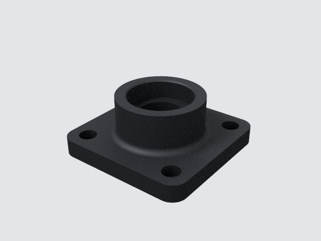 | **[Flanged bearing housing](bearing_housing/)** [script](bearing_housing/bearing_housing.py) · [drawing](bearing_housing/drawing.pdf) | A turned hub on a square flange: a revolved profile dimensioned by diameters about its drawn axis, counterbored holes for M8 cap screws in a circular pattern, fillets and a section through the bore. |
| 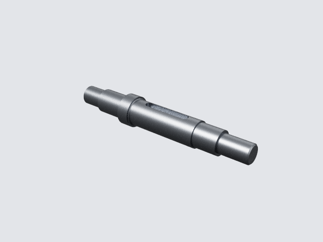 | **[Turned drive shaft](turned_shaft/)** [script](turned_shaft/turned_shaft.py) · [drawing](turned_shaft/drawing.pdf) | Six diameters on one revolved profile, chained lengths, an M16 cosmetic thread, a keyway cut down to a datum plane and shown in a section, chamfers and corner rounds; drawn at 2:1. |
| 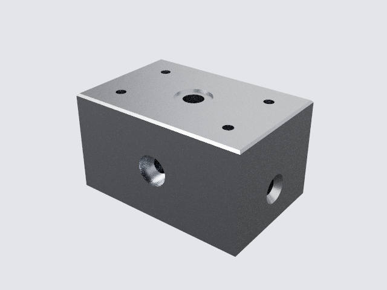 | **[Hydraulic manifold block](manifold_block/)** [script](manifold_block/manifold_block.py) · [drawing](manifold_block/drawing.pdf) | Drilled ports that meet inside an aluminium block: a spot-faced pressure port, a counterbored and a countersunk side port, four tapped M6 holes, and two sections that show the bores meet. |
| 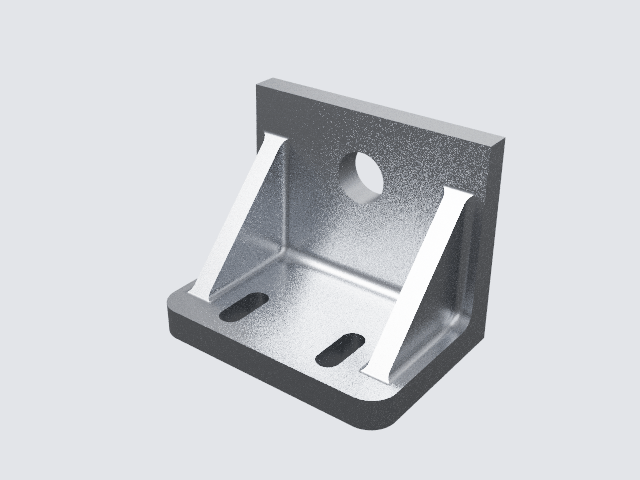 | **[Cast angle bracket](cast_bracket/)** [script](cast_bracket/cast_bracket.py) · [drawing](cast_bracket/drawing.pdf) | An L profile extruded both ways, a 2° casting draft, a rib and mounting slots each made once and mirrored, an H7 bore, and fillets on every inside corner. |
| 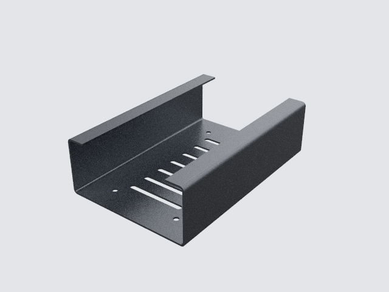 | **[Vented sheet-metal cover](sheet_metal_cover/)** [script](sheet_metal_cover/sheet_metal_cover.py) · [drawing](sheet_metal_cover/drawing.pdf) | Driven by named values you can change on the command line: a base with flanges and inward lips bent along its edges, a row of vent slots, mounting holes, and its flat pattern on a sheet of its own. |
| 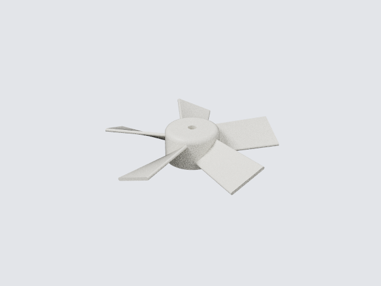 | **[Axial fan](axial_fan/)** [script](axial_fan/axial_fan.py) · [drawing](axial_fan/drawing.pdf) | A turned hub and five twisted blades: one blade lofted from a root section to a tip section, each pitched at its own angle, and a circular feature pattern; a section shows the tip's pitch. |
| 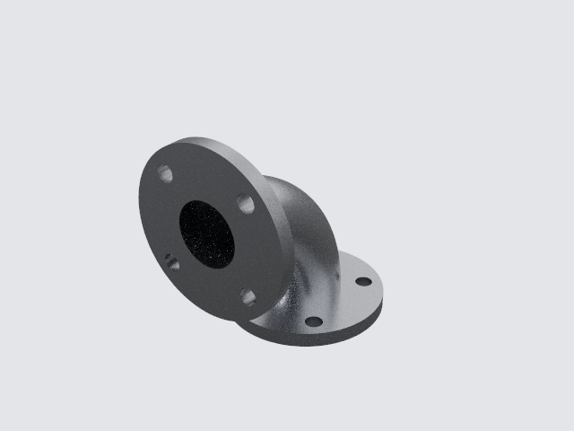 | **[Flanged 90° pipe elbow](pipe_elbow/)** [script](pipe_elbow/pipe_elbow.py) · [drawing](pipe_elbow/drawing.pdf) | A tube swept along a bend, a flange with four bolt holes, and the flange with its holes mirrored onto the other end in the plane that halves the bend. |
| 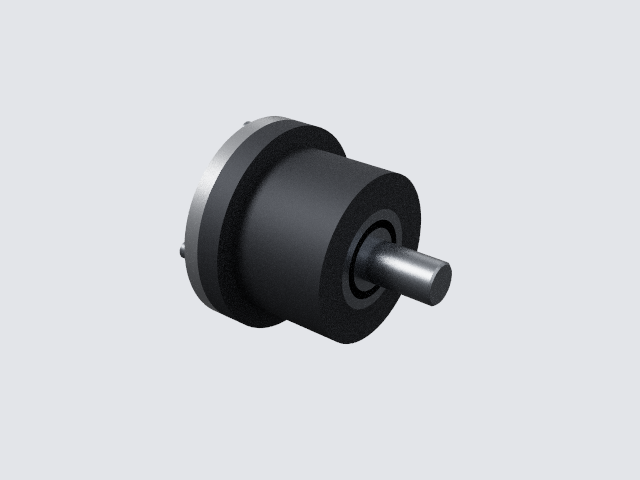 | **[Bearing unit (assembly)](bearing_unit/)** [script](bearing_unit/bearing_unit.py) · [drawing](bearing_unit/drawing.pdf) | A housing, a shaft turning in two catalogue 6204 bearings, a cover held by four catalogue M5 cap screws: joints, a part pattern, a section through the axis, a parts list and balloons. |
| 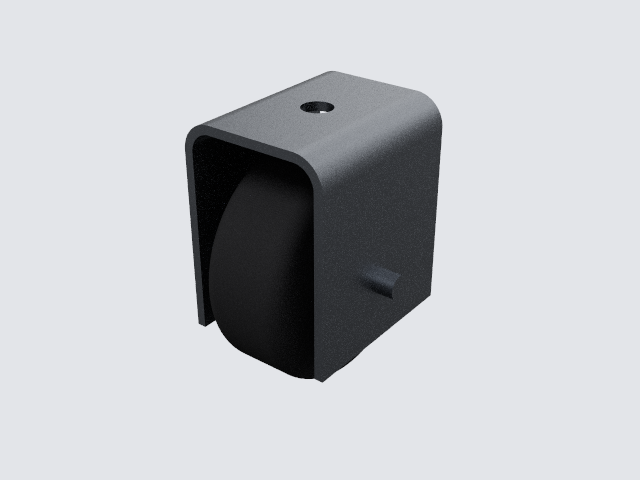 | **[Caster (assembly)](caster/)** [script](caster/caster.py) · [drawing](caster/drawing.pdf) | A shelled steel fork, a wheel of two bodies (aluminium hub, rubber tyre) each weighing by its own material, and an axle pin; the wheel turns on a revolute joint. |
| 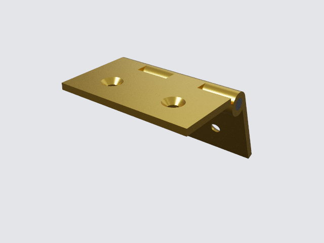 | **[Butt hinge (assembly)](butt_hinge/)** [script](butt_hinge/butt_hinge.py) · [drawing](butt_hinge/drawing.pdf) | One brass leaf part placed twice, the second turned end for end so the knuckles interleave, a steel pin, and a revolute joint driven open to 110°; knuckles, reliefs and countersunk holes are each one feature and a pattern. |
| 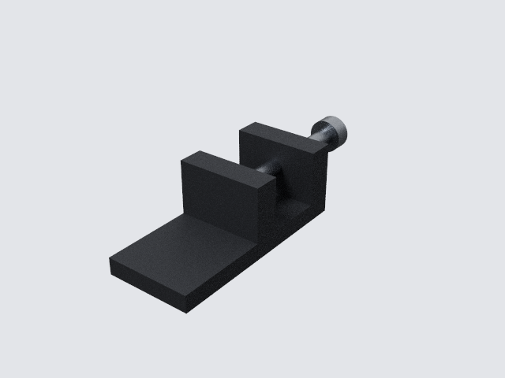 | **[Bench vise (assembly)](bench_vise/)** [script](bench_vise/bench_vise.py) · [drawing](bench_vise/drawing.pdf) | A cast body and moving jaw and an M12 screw: the jaw slides on the body, the screw turns in it, and a Drive step opens the vise to a width; built open and nearly shut, its section draws the screw whole. |
